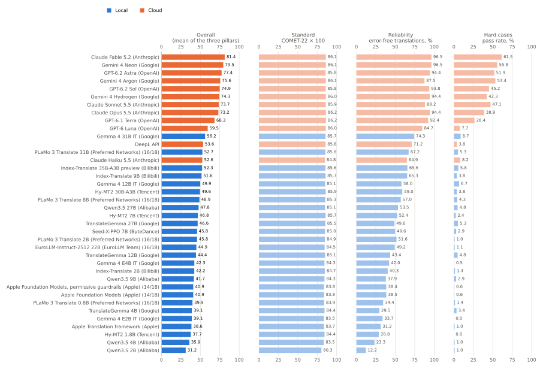
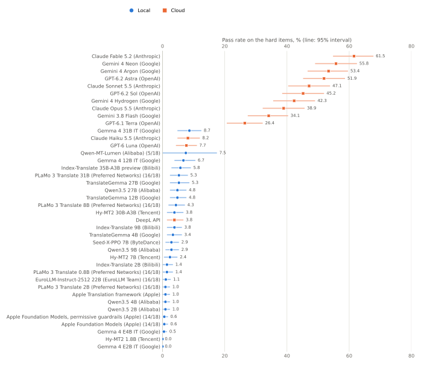
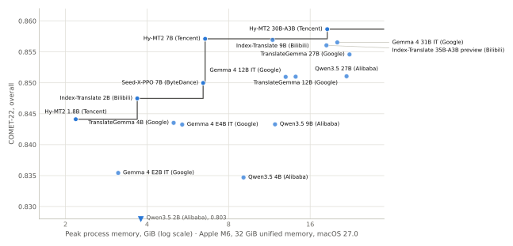
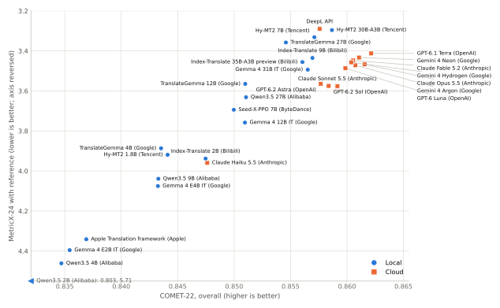

# Translate Bench

[English](README.md) · [日本語](README.ja.md)

ローカルモデルとクラウドサービスの翻訳を、品質・速度・メモリで比べる再現可能なベンチマークです。

**[リーダーボード](https://takechanman1228.github.io/translate-bench/)** · [評価方法](docs/methodology.md) · [指標](docs/metrics.md) · [制約](docs/limitations.md) · [再現手順](docs/reproduce.md)（リンク先は英語）

<!-- tb:counts -->
- **構成：** 40（ローカル27、クラウド13）。うち31構成が18方向すべてに対応。
- **評価データ：** 英語と9言語の間の18方向。各方向にニュース文200文と長めの文章20件（合計3,960件）。
- **実行環境：** ローカルモデルはメモリ32 GiBのApple M6 1台で実行。
- **品質の指標：** COMET-22、MetricX-24、LLMによる判定、Last Translation Benchmarkの難しい例208件を並べて示し、うち3つを平均した[総合スコア](#総合スコア)も付ける。
<!-- /tb:counts -->

<!-- tb:lead-caption -->


*総合スコアを持つ38構成を、その順に並べた（青：ローカル、橙：クラウド）。左から、同じ0〜100の目盛りで、総合スコア、その3つの柱であるCOMET-22×100、誤りのない訳の割合、難しい例208件の合格率。18方向に満たない構成には（16/18）のように対応する方向の数を添え、その方向だけで計算した。*
<!-- /tb:lead-caption -->

## 結果

<!-- tb:top -->
[総合スコア](#総合スコア)を持つ38構成のうち、上位12構成を示します。総合スコアは、COMET-22、誤りのない訳の割合、難しい例の合格率の平均です。全40構成は[リーダーボード](https://takechanman1228.github.io/translate-bench/)にあります。

| 構成 | 種類 | 総合 ↑ | COMET-22 ↑ | 誤りなし ↑ | 難しい例 ↑ | ピークメモリ | 1文あたり |
| --- | --- | --- | --- | --- | --- | --- | --- |
| Claude Fable 5.2 | クラウド | 81.4 | 0.8605 | 96.5% | 61.5% | — | — |
| Gemini 4 Neon | クラウド | 79.5 | 0.8611 | 96.5% | 55.8% | — | — |
| GPT-6.2 Astra | クラウド | 77.4 | 0.8577 | 94.4% | 51.9% | — | — |
| Gemini 4 Argon | クラウド | 75.6 | 0.8607 | 87.5% | 53.4% | — | — |
| GPT-6.2 Sol | クラウド | 74.9 | 0.8584 | 93.8% | 45.2% | — | — |
| Gemini 4 Hydrogen | クラウド | 74.3 | 0.8604 | 94.4% | 42.3% | — | — |
| Claude Sonnet 5.5 | クラウド | 73.7 | 0.8591 | 88.2% | 47.1% | — | — |
| Claude Opus 5.5 | クラウド | 73.2 | 0.8616 | 94.4% | 38.9% | — | — |
| GPT-6.1 Terra | クラウド | 68.3 | 0.8621 | 92.4% | 26.4% | — | — |
| GPT-6 Luna | クラウド | 59.5 | 0.8599 | 84.7% | 7.7% | — | — |
| Gemma 4 31B IT | ローカル | 56.2 | 0.8565 | 74.3% | 8.7% | 20.14 GiB | 5.50 s |
| DeepL API | クラウド | 53.6 | 0.8576 | 71.2% | 3.8% | — | — |

先頭はClaude Fable 5.2（81.4）とGemini 4 Neon（79.5）で、差は1.9ポイント。難しい例208件の不確かさの範囲内なので、どちらか一方を勝者とせず、先頭集団として扱います。

クラウド構成には1回の依頼で最大25文または文章5件をまとめて渡し、ローカルモデルには1件ずつ渡しました。メモリと1文あたりの時間はローカル構成だけに示します。
<!-- /tb:top -->

### 結果から分かること

<!-- tb:findings -->
1. **標準的な指標では、クラウドとローカルの差は小さい。** COMET-22で、総合スコア上位10構成（すべてクラウド）は0.8577〜0.8621の範囲にある。COMET-22のローカル首位Hy-MT2 30B-A3B（0.8587）もその範囲に入る。
2. **難しい例では差が大きい。** 208件の難しい例で、クラウドの7構成が40%以上（42.3%〜61.5%）に合格した。ローカルは27構成すべてが、208件全体で数えても対応する方向の項目だけで数えても10%未満で、最も高いGemma 4 31B ITでも8.7%。DeepL APIは3.8%。
3. **総合スコアでローカル首位のGemma 4 31B ITは、DeepL APIを上回る**（56.2対53.6）。COMET-22は低い（0.8565対0.8576）が、誤りのない訳の割合（74.3%対71.2%）と難しい例の合格率（8.7%対3.8%）で上回る。

3つの柱の定義は[総合スコア](#総合スコア)にあります。方向別の結果は[リーダーボード](https://takechanman1228.github.io/translate-bench/)にあります。
<!-- /tb:findings -->

### 総合スコア

<!-- tb:overall -->
総合スコアは、0〜100に揃えた3つの柱を同じ重みで平均し、小数第1位に丸めたものです。

- **標準：** その構成が対応する方向（ほとんどは18方向すべて）のCOMET-22を100倍した値。
- **信頼性：** LLMによる判定の標本のうち、Claude Fable 5.2が誤りを1つも付けなかった訳の割合（%）。
- **難しい例：** [Last Translation Benchmark](https://github.com/zouharvi/last-translation-benchmark)（LTB。Zouhar et al., 2026、[arXiv:2609.04173](https://arxiv.org/abs/2609.04173)、データはCC BY 4.0）のうち、方向がこのベンチマークと重なる208件の合格率（%）。訳文が手書きの規則をすべて満たすと合格で、判定はClaude Sonnet 5.5が行う。LTBの公式リーダーボードの数値ではない。このベンチマークの方向にある208件だけを使い、判定するモデルも異なる（[プロトコル](results/ltb-v1/protocol.md)）。

総合スコアは、3つの柱のどれもが18方向のうち12方向以上に対応する構成に付けます（40構成中38構成）。うち7構成は18方向に満たない：PLaMo 3 Translate 0.8B、2B、8B、31B（ポルトガル語（ブラジル）なし、16/18）、EuroLLM-Instruct-2512 22B（インドネシア語なし、16/18）、Apple Foundation Modelsの2構成（アラビア語とインドネシア語なし、14/18）。これらの柱は対応する方向だけの平均で、難しい例もその方向の項目だけで数えます。リーダーボードでは対応する方向の数を添えて示します。Qwen-MT-Lumen（文と文章の両方がそろう方向が5）とGemini 3.8 Flash（文と文章の両方がそろう方向がない）には総合スコアがありません。

方向が少ない平均は、同じ試験ではありません。18方向すべてに対応した31構成で、上の構成と同じ16・14方向だけに絞ると、COMET-22×100は最大0.44ポイント（平均で−0.25〜+0.13）動きます。Qwen-MT-Lumenの5方向だけにすると平均2.0ポイント動くため、その構成には総合スコアを付けません。MetricX-24は別の列として示し、総合スコアには含めません。総合スコアに区間はありません。各構成の柱の値と対応する方向の数は[`results/v1.1/overall.json`](results/v1.1/overall.json) にあり、`translate-bench verify` が計算し直します。

**注意点：** LLMによる判定はClaude Fable 5.2、難しい例の判定はClaude Sonnet 5.5が行っています。総合スコア上位10構成（すべてクラウド）の難しい例は、LTBが使うGemini 3.8 Flashでも判定し直しました。2,080件のうち97.1%で判定が一致し、合格率の差は3.4ポイント以内、順位は1件差の2構成が入れ替わったほかは同じでした。LLMによる判定の柱には、このような2つ目の判定はありません。
<!-- /tb:overall -->

<details>
<summary>ほかの図</summary>

<!-- tb:figures -->


*全40構成の、Last Translation Benchmarkの難しい例208件の合格率と、項目についての95%区間（青：ローカル、橙：クラウド）。規則の判定はClaude Sonnet 5.5が行う。18方向に満たない構成には（16/18）のように対応する方向の数を添え、その方向の項目だけで計算した。*


*複数のサイズを測ったローカル6系列の、総パラメータ数（対数軸）とCOMET-22。白抜きの点（PLaMo 3 Translate）は、ポルトガル語（ブラジル）に対応しないため16方向の平均。横線はGPT-6.1 TerraとDeepL API。*



*ローカル18構成の、推論プロセスのピークメモリ（対数軸）とCOMET-22。線はパレート境界。Appleの端末内システムはシステムサービスで動き、ピークメモリを測定していないため除いた。*



*18方向すべてに対応した31構成の、COMET-22とMetricX-24。MetricX-24の軸は反転してあり、上と右がどちらも良い。*
<!-- /tb:figures -->

</details>

## 指標

<!-- tb:metrics -->
| 指標 | 測っているもの | ローカル首位 | クラウド首位 |
| --- | --- | --- | --- |
| 総合 ↑ | COMET-22×100、誤りなしの割合、難しい例の合格率の平均（[総合スコア](#総合スコア)） | Gemma 4 31B IT (56.2) | Claude Fable 5.2 (81.4) |
| COMET-22 ↑ | 訳文を参照訳と比べる学習済みの指標 | Hy-MT2 30B-A3B (0.8587) | GPT-6.1 Terra (0.8621) |
| MetricX-24 ↓ | 同じ種類のもう1つの学習済み指標（誤りの大きさを表す） | Hy-MT2 30B-A3B (3.296) | DeepL API (3.290) |
| 判定（対DeepL API）↑ | LLMによる判定（Claude Fable 5.2）でDeepL APIより良いとされた割合（引き分けを除く） | Gemma 4 31B IT (39%) | GPT-6.2 Astra (88%) |
| 誤りなし ↑ | LLMによる判定で誤りが1つも付かなかった訳の割合 | Gemma 4 31B IT (74%) | Gemini 4 Neon, Claude Fable 5.2 (97%) |
| 難しい例 ↑ | 難しい例208件（Last Translation Benchmark）のうち、手書きの規則をすべて満たした割合（Claude Sonnet 5.5が判定） | Gemma 4 31B IT (8.7%) | Claude Fable 5.2 (61.5%) |
| chrF++ ↑ | 参照訳との文字・単語の重なり | Gemma 4 31B IT (55.60) | Gemini 4 Argon (58.19) |
| 完了率 ↑ | 依頼した項目のうち、スコアが付いた項目の割合 | 19構成中16構成が100%（最低99.9%） | 12構成中11構成が100%（最低99.4%） |

18方向すべてに対応した31構成（ローカル19、クラウド12）の中での首位。
<!-- /tb:metrics -->

品質の指標は、各方向の中で文と文章を半分ずつの重みで平均します。18方向は同じ重みです。詳しくは[指標の読み方](docs/metrics.md)にあります。

## 使い方

Python 3.11または3.12が必要です。

### 公開している数値を確かめる

GPUもAPIキーも要りません。`verify` は、項目ごとの行からスコア、順位、区間、総合スコアを計算し直します。`leaderboard` は、総合スコアの順に表を出力します。

```sh
git clone https://github.com/takechanman1228/translate-bench.git && cd translate-bench
python -m pip install -e .
translate-bench verify
translate-bench leaderboard
translate-bench leaderboard --metric metricx24_ref --pairs en-ja
```

### 自分のモデルを評価する

`run` は、OpenAI互換のエンドポイントなら何でも使えます（llama-server、Ollama、LM Studio、vLLM、各社のAPI）。

```sh
python -m pip install -e '.[comet]'
translate-bench prepare        # 評価データを取得し、ハッシュと照合
translate-bench run --model my-model --base-url http://127.0.0.1:8080/v1 --out private/runs/my-model
translate-bench score --predictions private/runs/my-model/predictions.jsonl \
    --system-name my-model --metrics chrf,comet22 --out private/runs/my-model/score
translate-bench compare --results private/runs/my-model/score
```

`compare` は、採点した方向について、公開している構成と自分のモデルを比べます。`run` は、指定したエンドポイントに原文を送ります。

各コマンドのオプションは `--help` で確認できます。通しの手順は[再現手順](docs/reproduce.md)に、実行例は [examples/](examples/) にあります。結果をリーダーボードに載せる方法は、[CONTRIBUTING.md](CONTRIBUTING.md) を見てください。

## リポジトリにあるもの

- **公開しているもの：** 項目ごとのスコア、原文・参照訳・訳文すべてのSHA-256、構成の台帳（重み、リビジョン、プロンプト、設定）、速度とメモリ、判定の結果。[`results/v1/`](results/v1/)、[`configs/systems.json`](configs/systems.json)、[`datasets/`](datasets/) にあります。
- **公開していないもの：** 評価データの本文、参照訳、モデルの訳文。本文は `translate-bench prepare` が取得し、ハッシュと照合します。本文が手元にあれば、どの訳文が参照訳や原文と同一かをハッシュから確認できます。
- **v1.1で加えたもの：** [`results/v1/`](results/v1/) はv1.0から変えていません。v1.1では、難しい例の評価（[`results/ltb-v1/`](results/ltb-v1/protocol.md)。項目ごとの判定とハッシュのみで、本文は含まない）と総合スコア（[`results/v1.1/overall.json`](results/v1.1/overall.json)）を加えました。[変更履歴](CHANGELOG.md)も参照してください。

## 引用

takechanman1228 (2026). *Translate Bench v1.1: a reproducible benchmark for translation quality, speed, and memory across local models and cloud services.* https://github.com/takechanman1228/translate-bench

機械可読な形式は [CITATION.cff](CITATION.cff) にあります。

## ライセンス

- **コード：** Apache-2.0（[LICENSE](LICENSE)）。
- **スコア、表、図、結果の文書：** CC BY 4.0（[LICENSE-results.md](LICENSE-results.md)）。評価のためのもので、モデルの学習には使わないでください。
- **評価データ、モデルの重み、サービス：** それぞれの条件に従います（[DATA_AND_MODEL_LICENSES.md](DATA_AND_MODEL_LICENSES.md)）。
