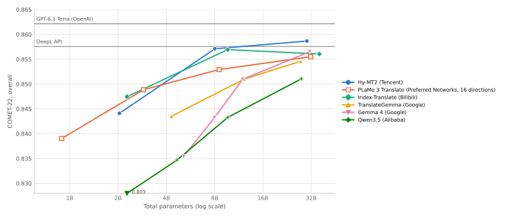

# Translate Bench

[English](README.md) · [日本語](README.ja.md)

ローカルモデルとクラウドサービスの翻訳を、品質・速度・メモリで比べる再現可能なベンチマークです。

**[リーダーボード](https://takechanman1228.github.io/translate-bench/)** · [評価方法](docs/methodology.md) · [指標](docs/metrics.md) · [制約](docs/limitations.md) · [再現手順](docs/reproduce.md)（リンク先は英語）

<!-- tb:counts -->
- **構成：** 40（ローカル27、クラウド13）。うち31構成が18方向すべてに対応。
- **評価データ：** 英語と9言語の間の18方向。各方向にニュース文200文と長めの文章20件（合計3,960件）。
- **実行環境：** ローカルモデルはメモリ32 GiBのApple M6 1台で実行。
- **品質の指標：** COMET-22、MetricX-24、LLMによる判定。1つのスコアにはまとめず、並べて示す。
<!-- /tb:counts -->


<!-- tb:lead-caption -->
*18方向すべてに対応した31構成を、COMET-22の順に並べた（青：ローカル、橙：クラウド）。左から、COMET-22（高いほど良い）、MetricX-24（低いほど良い）、LLMによる判定でDeepL APIより良いとされた割合（引き分けを除く）。*
<!-- /tb:lead-caption -->

## 結果

<!-- tb:top -->
18方向すべてに対応した31構成のうち、COMET-22の上位5構成をクラウドとローカルそれぞれで示します。全40構成は[リーダーボード](https://takechanman1228.github.io/translate-bench/)にあります。

| 構成 | 種類 | COMET-22 ↑ | MetricX-24 ↓ | 判定（対DeepL API）↑ | 誤りなし ↑ | ピークメモリ | 1文あたり |
| --- | --- | --- | --- | --- | --- | --- | --- |
| GPT-6.1 Terra | クラウド | 0.8621 | 3.412 | 72% | 92% | — | — |
| Claude Opus 5.5 | クラウド | 0.8616 | 3.467 | 75% | 94% | — | — |
| Gemini 4 Neon | クラウド | 0.8611 | 3.433 | 70% | 97% | — | — |
| Gemini 4 Argon | クラウド | 0.8607 | 3.472 | 62% | 88% | — | — |
| Claude Fable 5.2 | クラウド | 0.8605 | 3.448 | 75% | 97% | — | — |
| Hy-MT2 30B-A3B | ローカル | 0.8587 | 3.296 | 30% | 59% | 18.49 GiB | 0.82 s |
| Hy-MT2 7B | ローカル | 0.8571 | 3.332 | 13% | 52% | 6.55 GiB | 1.54 s |
| Index-Translate 9B | ローカル | 0.8569 | 3.435 | 33% | 65% | 11.62 GiB | 1.56 s |
| Gemma 4 31B IT | ローカル | 0.8565 | 3.494 | 39% | 74% | 20.14 GiB | 5.50 s |
| Index-Translate 35B-A3B preview | ローカル | 0.8560 | 3.456 | 34% | 66% | 18.37 GiB | 0.96 s |

クラウド構成には1回の依頼で最大25文または文章5件をまとめて渡し、ローカルモデルには1件ずつ渡しました。メモリと1文あたりの時間はローカル構成だけに示します。
<!-- /tb:top -->

### 結果から分かること

<!-- tb:findings -->
1. **翻訳専用の小さなモデルは、3.5〜4.2倍大きい汎用モデルに並ぶ。** COMET-22で、Index-Translate 2B（0.8475）はQwen3.5 9B（0.8433）とGemma 4 E4B IT（0.8432）を上回り、Claude Haiku 5.5（0.8476）と同等。Hy-MT2 7B（0.8571）はQwen3.5 27B（0.8511）を上回り、Gemma 4 31B IT（0.8565）と同等（[図](figures/size-quality.svg)）。
2. **ローカル首位は、COMET-22でクラウド首位と0.0035差。ただしLLMによる判定では大きく離される。** Hy-MT2 30B-A3Bは0.8587、GPT-6.1 Terraは0.8621。MetricX-24ではHy-MT2 30B-A3Bが上（3.296対3.412、低いほど良い）。判定でDeepL APIより良いとされた割合（引き分けを除く）は、GPT-6.1 Terraが72%、Hy-MT2 30B-A3Bが30%。DeepL APIを上回ったのはクラウドの9構成で、ローカルにはない。18方向すべてに対応したローカル構成で最も近いのは、Gemma 4 31B ITの39%。
3. **Hy-MT2 7Bは、約3分の1のメモリでローカル首位とCOMET-22が0.0016差。** ピーク6.55 GiBで0.8571。首位のHy-MT2 30B-A3Bは18.49 GiBで0.8587。4 GiB以内ではIndex-Translate 2Bが3.68 GiBで0.8475（[図](figures/quality-memory.svg)）。
4. **30BのMixture-of-Expertsモデルは、MoEではない7Bのモデルより約2倍速い。** Hy-MT2 30B-A3Bが1トークンあたりに使うのは、30Bのパラメータのうち約3B。1文の翻訳は0.82秒で、Hy-MT2 7Bは1.54秒。メモリは2.8倍使う。

「同等」は、差の対応のある95%区間がゼロを含むことを指します（[指標の読み方](docs/metrics.md)）。方向別の結果は[リーダーボード](https://takechanman1228.github.io/translate-bench/)にあります。
<!-- /tb:findings -->

<details>
<summary>ほかの図</summary>

<!-- tb:figures -->


*複数のサイズを測ったローカル6系列の、総パラメータ数（対数軸）とCOMET-22。白抜きの点（PLaMo 3 Translate）は、ポルトガル語（ブラジル）に対応しないため16方向の平均。横線はGPT-6.1 TerraとDeepL API。*


*ローカル18構成の、推論プロセスのピークメモリ（対数軸）とCOMET-22。線はパレート境界。Appleの端末内システムはシステムサービスで動き、ピークメモリを測定していないため除いた。*


*18方向すべてに対応した31構成の、COMET-22とMetricX-24。MetricX-24の軸は反転してあり、上と右がどちらも良い。*
<!-- /tb:figures -->

</details>

## 指標

<!-- tb:metrics -->
| 指標 | 測っているもの | ローカル首位 | クラウド首位 |
| --- | --- | --- | --- |
| COMET-22 ↑ | 訳文を参照訳と比べる学習済みの指標 | Hy-MT2 30B-A3B (0.8587) | GPT-6.1 Terra (0.8621) |
| MetricX-24 ↓ | 同じ種類のもう1つの学習済み指標（誤りの大きさを表す） | Hy-MT2 30B-A3B (3.296) | DeepL API (3.290) |
| 判定（対DeepL API）↑ | LLMによる判定（Claude Fable 5.2）でDeepL APIより良いとされた割合（引き分けを除く） | Gemma 4 31B IT (39%) | GPT-6.2 Astra (88%) |
| 誤りなし ↑ | LLMによる判定で誤りが1つも付かなかった訳の割合 | Gemma 4 31B IT (74%) | Gemini 4 Neon, Claude Fable 5.2 (97%) |
| chrF++ ↑ | 参照訳との文字・単語の重なり | Gemma 4 31B IT (55.60) | Gemini 4 Argon (58.19) |
| 完了率 ↑ | 依頼した項目のうち、スコアが付いた項目の割合 | 19構成中16構成が100%（最低99.9%） | 12構成中11構成が100%（最低99.4%） |

18方向すべてに対応した31構成（ローカル19、クラウド12）の中での首位。
<!-- /tb:metrics -->

品質の指標は、各方向の中で文と文章を半分ずつの重みで平均します。18方向は同じ重みです。詳しくは[指標の読み方](docs/metrics.md)にあります。

## 使い方

Python 3.11または3.12が必要です。

### 公開している数値を確かめる

GPUもAPIキーも要りません。`verify` は、項目ごとの行からスコア、順位、区間を計算し直します。

```sh
git clone https://github.com/takechanman1228/translate-bench.git && cd translate-bench
python -m pip install -e .
translate-bench verify
translate-bench leaderboard --metric metricx24_ref --pairs en-ja
```

### 自分のモデルを評価する

`run` は、OpenAI互換のエンドポイントなら何でも使えます（llama-server、Ollama、LM Studio、vLLM、各社のAPI）。

```sh
python -m pip install -e '.[comet]'
translate-bench prepare        # 評価データを取得し、ハッシュと照合
translate-bench run --model my-model --base-url http://127.0.0.1:8080/v1 --out private/runs/my-model
translate-bench score --predictions private/runs/my-model/predictions.jsonl \
    --system-name my-model --metrics chrf,comet22 --out private/runs/my-model/score
translate-bench compare --results private/runs/my-model/score
```

`compare` は、採点した方向について、公開している構成と自分のモデルを比べます。`run` は、指定したエンドポイントに原文を送ります。

各コマンドのオプションは `--help` で確認できます。通しの手順は[再現手順](docs/reproduce.md)に、実行例は [examples/](examples/) にあります。結果をリーダーボードに載せる方法は、[CONTRIBUTING.md](CONTRIBUTING.md) を見てください。

## リポジトリにあるもの

- **公開しているもの：** 項目ごとのスコア、原文・参照訳・訳文すべてのSHA-256、構成の台帳（重み、リビジョン、プロンプト、設定）、速度とメモリ、判定の結果。[`results/v1/`](results/v1/)、[`configs/systems.json`](configs/systems.json)、[`datasets/`](datasets/) にあります。
- **公開していないもの：** 評価データの本文、参照訳、モデルの訳文。本文は `translate-bench prepare` が取得し、ハッシュと照合します。本文が手元にあれば、どの訳文が参照訳や原文と同一かをハッシュから確認できます。

## 引用

takechanman1228 (2026). *Translate Bench v1.0: a reproducible benchmark for translation quality, speed, and memory across local models and cloud services.* https://github.com/takechanman1228/translate-bench

機械可読な形式は [CITATION.cff](CITATION.cff) にあります。

## ライセンス

- **コード：** Apache-2.0（[LICENSE](LICENSE)）。
- **スコア、表、図、結果の文書：** CC BY 4.0（[LICENSE-results.md](LICENSE-results.md)）。評価のためのもので、モデルの学習には使わないでください。
- **評価データ、モデルの重み、サービス：** それぞれの条件に従います（[DATA_AND_MODEL_LICENSES.md](DATA_AND_MODEL_LICENSES.md)）。
