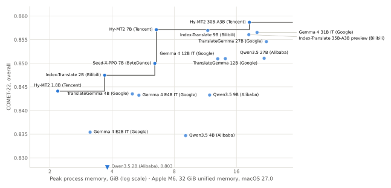

# Translate Bench

[English](README.md) · [日本語](README.ja.md)

A reproducible benchmark for translation quality, speed, and memory across local models and cloud services.

**[Leaderboard](https://takechanman1228.github.io/translate-bench/)** · [Methodology](docs/methodology.md) · [Metrics](docs/metrics.md) · [Limitations](docs/limitations.md) · [Reproduce](docs/reproduce.md)

<!-- tb:counts -->
- **Systems:** 40 configurations (27 local, 13 cloud). 31 cover all 18 directions.
- **Test set:** 18 directions between English and 9 languages. Each has 200 news sentences and 20 longer passages (3,960 items in total).
- **Hardware:** local models ran on one Apple M6 with 32 GiB of memory.
- **Quality:** COMET-22, MetricX-24 and an LLM judge, reported side by side. There is no combined score.
<!-- /tb:counts -->


<!-- tb:lead-caption -->
*The 31 systems that cover all 18 directions, sorted by COMET-22 (blue: local, orange: cloud). Left to right: COMET-22 (higher is better), MetricX-24 (lower is better), and the share of non-tied items where the LLM judge preferred the system to DeepL API.*
<!-- /tb:lead-caption -->

## Results

<!-- tb:top -->
The top five cloud and top five local systems by COMET-22, among the 31 that cover all 18 directions. All 40 are on the [leaderboard](https://takechanman1228.github.io/translate-bench/).

| System | Type | COMET-22 ↑ | MetricX-24 ↓ | Judge vs DeepL API ↑ | Error-free ↑ | Peak memory | Per sentence |
| --- | --- | --- | --- | --- | --- | --- | --- |
| GPT-6.1 Terra | Cloud | 0.8621 | 3.412 | 72% | 92% | — | — |
| Claude Opus 5.5 | Cloud | 0.8616 | 3.467 | 75% | 94% | — | — |
| Gemini 4 Neon | Cloud | 0.8611 | 3.433 | 70% | 97% | — | — |
| Gemini 4 Argon | Cloud | 0.8607 | 3.472 | 62% | 88% | — | — |
| Claude Fable 5.2 | Cloud | 0.8605 | 3.448 | 75% | 97% | — | — |
| Hy-MT2 30B-A3B | Local | 0.8587 | 3.296 | 30% | 59% | 18.49 GiB | 0.82 s |
| Hy-MT2 7B | Local | 0.8571 | 3.332 | 13% | 52% | 6.55 GiB | 1.54 s |
| Index-Translate 9B | Local | 0.8569 | 3.435 | 33% | 65% | 11.62 GiB | 1.56 s |
| Gemma 4 31B IT | Local | 0.8565 | 3.494 | 39% | 74% | 20.14 GiB | 5.50 s |
| Index-Translate 35B-A3B preview | Local | 0.8560 | 3.456 | 34% | 66% | 18.37 GiB | 0.96 s |

Cloud systems received up to 25 sentences or 5 passages per request, and local models one item per request. Memory and time per sentence are shown for local systems only.
<!-- /tb:top -->

### What the results show

<!-- tb:findings -->
1. **Small translation models match general models 3.5 to 4.2 times their size.** On COMET-22, Index-Translate 2B (0.8475) beats Qwen3.5 9B (0.8433) and Gemma 4 E4B IT (0.8432), and ties Claude Haiku 5.5 (0.8476). Hy-MT2 7B (0.8571) beats Qwen3.5 27B (0.8511) and ties Gemma 4 31B IT (0.8565) ([figure](figures/size-quality.svg)).
2. **The best local model is within 0.0035 COMET-22 of the best cloud model, but far behind it on the LLM judge.** Hy-MT2 30B-A3B scores 0.8587 against 0.8621 for GPT-6.1 Terra, and is ahead on MetricX-24 (3.296 against 3.412, lower is better). The judge preferred GPT-6.1 Terra to DeepL API on 72% of non-tied items, and Hy-MT2 30B-A3B on 30%. Nine cloud systems beat DeepL API on the judge. No local system does. Among those with all 18 directions, Gemma 4 31B IT comes closest at 39%.
3. **Hy-MT2 7B comes within 0.0016 COMET-22 of the best local model on about a third of the memory.** It scores 0.8571 at a peak of 6.55 GiB, against 0.8587 at 18.49 GiB for Hy-MT2 30B-A3B. Under 4 GiB, Index-Translate 2B scores 0.8475 at 3.68 GiB ([figure](figures/quality-memory.svg)).
4. **The 30B mixture-of-experts model is about twice as fast as the 7B dense model.** Hy-MT2 30B-A3B activates about 3B of its 30B parameters per token. It translates a sentence in 0.82 s, against 1.54 s for Hy-MT2 7B, and uses 2.8 times the memory.

"Ties" means the paired 95% interval of the difference includes zero ([Reading the metrics](docs/metrics.md)). Results by direction are on the [leaderboard](https://takechanman1228.github.io/translate-bench/).
<!-- /tb:findings -->

<details>
<summary>More figures</summary>

<!-- tb:figures -->


*COMET-22 by total parameter count (log scale) for the 6 local families measured at more than one size. Hollow points (PLaMo 3 Translate) average 16 directions, because it has no Brazilian Portuguese. The horizontal lines mark GPT-6.1 Terra and DeepL API.*



*COMET-22 against peak memory of the inference process (log scale) for 18 local systems. The line is the Pareto frontier. Apple's on-device systems are left out: they run in system services, so no peak was measured.*


*COMET-22 against MetricX-24 for the 31 systems that cover all 18 directions. The MetricX-24 axis is reversed, so up and right are both better.*
<!-- /tb:figures -->

</details>

## Metrics

<!-- tb:metrics -->
| Metric | What it measures | Best local | Best cloud |
| --- | --- | --- | --- |
| COMET-22 ↑ | Learned metric that compares the output with a reference translation | Hy-MT2 30B-A3B (0.8587) | GPT-6.1 Terra (0.8621) |
| MetricX-24 ↓ | A second learned metric of the same kind, as an error score | Hy-MT2 30B-A3B (3.296) | DeepL API (3.290) |
| Judge vs DeepL API ↑ | Share of non-tied items where the LLM judge (Claude Fable 5.2) preferred the system to DeepL API | Gemma 4 31B IT (39%) | GPT-6.2 Astra (88%) |
| Error-free ↑ | Share of items where the LLM judge marked no error | Gemma 4 31B IT (74%) | Gemini 4 Neon, Claude Fable 5.2 (97%) |
| chrF++ ↑ | Character and word overlap with the reference | Gemma 4 31B IT (55.60) | Gemini 4 Argon (58.19) |
| Completion ↑ | Share of attempted items that received a score | 16 of 19 at 100% (lowest 99.9%) | 11 of 12 at 100% (lowest 99.4%) |

Best among the 31 systems that cover all 18 directions (19 local, 12 cloud).
<!-- /tb:metrics -->

For the quality metrics, sentences and passages each count for half within a direction, and the 18 directions count equally. Details are in [Reading the metrics](docs/metrics.md).

## Quick start

Requires Python 3.11 or 3.12.

### Check the published numbers

No GPU or API key is needed. `verify` recomputes the scores, rankings and intervals from the per-item rows.

```sh
git clone https://github.com/takechanman1228/translate-bench.git && cd translate-bench
python -m pip install -e .
translate-bench verify
translate-bench leaderboard --metric metricx24_ref --pairs en-ja
```

### Evaluate your own model

`run` works with any OpenAI-compatible endpoint: llama-server, Ollama, LM Studio, vLLM or a hosted API.

```sh
python -m pip install -e '.[comet]'
translate-bench prepare        # download the test sets and check their hashes
translate-bench run --model my-model --base-url http://127.0.0.1:8080/v1 --out private/runs/my-model
translate-bench score --predictions private/runs/my-model/predictions.jsonl \
    --system-name my-model --metrics chrf,comet22 --out private/runs/my-model/score
translate-bench compare --results private/runs/my-model/score
```

`compare` ranks your model against the published systems on the directions you scored. `run` sends the source texts to the endpoint you choose.

Each command lists its options with `--help`. [Reproduce](docs/reproduce.md) has the full walkthrough, and [examples/](examples/) has worked runs. To add your results to the leaderboard, see [CONTRIBUTING.md](CONTRIBUTING.md).

## What is in the repository

- **Published:** per-item scores, SHA-256 hashes of every source, reference and output, the system registry (weights, revisions, prompts, settings), speed and memory, and the judge's decisions. See [`results/v1/`](results/v1/), [`configs/systems.json`](configs/systems.json) and [`datasets/`](datasets/).
- **Not published:** the test texts, the references and the model outputs. `translate-bench prepare` downloads the texts and checks them against the hashes. With the texts, the hashes show which outputs are identical to a reference or a source.

## Citation

takechanman1228 (2026). *Translate Bench v1.0: a reproducible benchmark for translation quality, speed, and memory across local models and cloud services.* https://github.com/takechanman1228/translate-bench

Machine-readable: [CITATION.cff](CITATION.cff)

## Licences

- **Code:** Apache-2.0 ([LICENSE](LICENSE)).
- **Scores, tables, figures and result documents:** CC BY 4.0 ([LICENSE-results.md](LICENSE-results.md)). They are for evaluation, not for training models.
- **Test sets, model weights and services:** their own terms ([DATA_AND_MODEL_LICENSES.md](DATA_AND_MODEL_LICENSES.md)).
