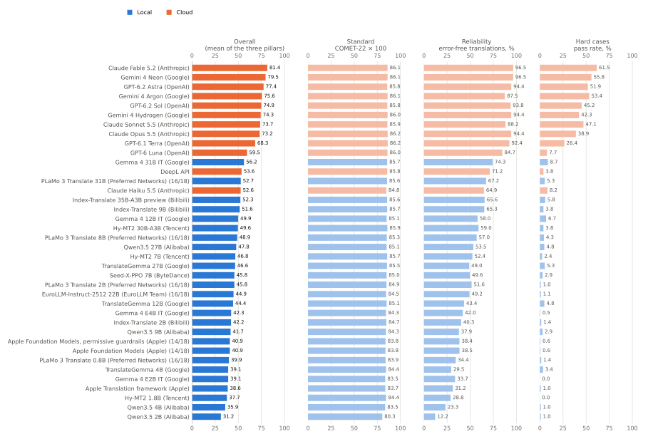
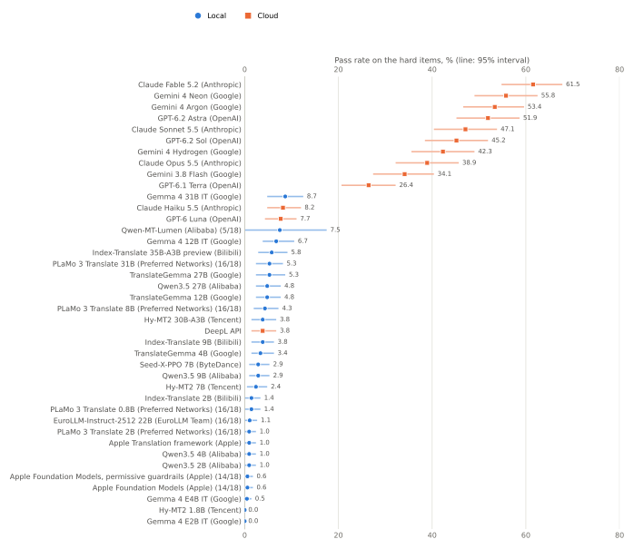
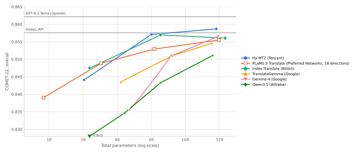
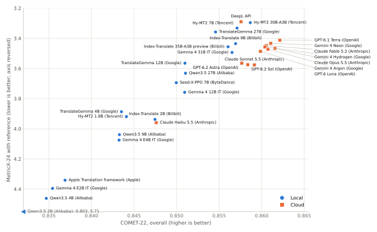

# Translate Bench

[English](README.md) · [日本語](README.ja.md)

A reproducible benchmark for translation quality, speed, and memory across local models and cloud services.

**[Leaderboard](https://takechanman1228.github.io/translate-bench/)** · [Methodology](docs/methodology.md) · [Metrics](docs/metrics.md) · [Limitations](docs/limitations.md) · [Reproduce](docs/reproduce.md)

<!-- tb:counts -->
- **Systems:** 40 configurations (27 local, 13 cloud). 31 cover all 18 directions.
- **Test set:** 18 directions between English and 9 languages. Each has 200 news sentences and 20 longer passages (3,960 items in total).
- **Hardware:** local models ran on one Apple M6 with 32 GiB of memory.
- **Quality:** COMET-22, MetricX-24, an LLM judge and 208 hard cases from the Last Translation Benchmark, side by side, plus an [Overall score](#overall-score) that averages three of them.
<!-- /tb:counts -->

<!-- tb:lead-caption -->


*The 38 systems with an Overall score, sorted by it (blue: local, orange: cloud). Left to right, on one 0–100 scale: the Overall score, then its three pillars: COMET-22 × 100, the share of error-free translations, and the pass rate on the 208 hard cases. A system below 18 directions carries its coverage, such as (16/18), and is scored over the directions it covers.*
<!-- /tb:lead-caption -->

## Results

<!-- tb:top -->
The top twelve of the 38 systems with an [Overall score](#overall-score), the mean of COMET-22, the share of error-free translations and the pass rate on hard cases. All 40 systems are on the [leaderboard](https://takechanman1228.github.io/translate-bench/).

| System | Type | Overall ↑ | COMET-22 ↑ | Error-free ↑ | Hard cases ↑ | Peak memory | Per sentence |
| --- | --- | --- | --- | --- | --- | --- | --- |
| Claude Fable 5.2 | Cloud | 81.4 | 0.8605 | 96.5% | 61.5% | — | — |
| Gemini 4 Neon | Cloud | 79.5 | 0.8611 | 96.5% | 55.8% | — | — |
| GPT-6.2 Astra | Cloud | 77.4 | 0.8577 | 94.4% | 51.9% | — | — |
| Gemini 4 Argon | Cloud | 75.6 | 0.8607 | 87.5% | 53.4% | — | — |
| GPT-6.2 Sol | Cloud | 74.9 | 0.8584 | 93.8% | 45.2% | — | — |
| Gemini 4 Hydrogen | Cloud | 74.3 | 0.8604 | 94.4% | 42.3% | — | — |
| Claude Sonnet 5.5 | Cloud | 73.7 | 0.8591 | 88.2% | 47.1% | — | — |
| Claude Opus 5.5 | Cloud | 73.2 | 0.8616 | 94.4% | 38.9% | — | — |
| GPT-6.1 Terra | Cloud | 68.3 | 0.8621 | 92.4% | 26.4% | — | — |
| GPT-6 Luna | Cloud | 59.5 | 0.8599 | 84.7% | 7.7% | — | — |
| Gemma 4 31B IT | Local | 56.2 | 0.8565 | 74.3% | 8.7% | 20.14 GiB | 5.50 s |
| DeepL API | Cloud | 53.6 | 0.8576 | 71.2% | 3.8% | — | — |

Claude Fable 5.2 (81.4) and Gemini 4 Neon (79.5) lead, 1.9 points apart. That gap is within the uncertainty of the 208 hard items, so the two form a leading group rather than one winner.

Cloud systems received up to 25 sentences or 5 passages per request, and local models one item per request. Memory and time per sentence are shown for local systems only.
<!-- /tb:top -->

### What the results show

<!-- tb:findings -->
1. **On the standard metric, cloud and local systems are close.** On COMET-22, the ten systems with the highest Overall score, all cloud, lie between 0.8577 and 0.8621. The best local system on COMET-22, Hy-MT2 30B-A3B (0.8587), lies between them.
2. **On hard cases, the gap is wide.** Seven cloud systems pass 40% or more of the 208 hard items (42.3% to 61.5%). Every one of the 27 local systems passes fewer than 10%, counted on all 208 items or only on those in the directions it covers; the best, Gemma 4 31B IT, passes 8.7%. DeepL API passes 3.8%.
3. **The top local system on Overall, Gemma 4 31B IT, is ahead of DeepL API** (56.2 against 53.6). Its COMET-22 is lower (0.8565 against 0.8576), but more of its translations are error-free (74.3% against 71.2%) and it passes more hard cases (8.7% against 3.8%).

The pillars are defined under [Overall score](#overall-score). Results by direction are on the [leaderboard](https://takechanman1228.github.io/translate-bench/).
<!-- /tb:findings -->

### Overall score

<!-- tb:overall -->
The Overall score is the mean of three pillars, each on a 0–100 scale and weighted equally, rounded to one decimal:

- **Standard:** COMET-22 over the directions the system covers (all 18 for most), times 100.
- **Reliability:** the share of the LLM judge's sample in which Claude Fable 5.2 marked no error, in percent.
- **Hard cases:** the pass rate on the 208 items of the [Last Translation Benchmark](https://github.com/zouharvi/last-translation-benchmark) (LTB; Zouhar et al., 2026, [arXiv:2609.04173](https://arxiv.org/abs/2609.04173); data CC BY 4.0) whose direction is one of this benchmark's, in percent. An item passes when the translation meets all of its handwritten rules, as checked by Claude Sonnet 5.5. These are not official LTB leaderboard numbers: they use a 208-item subset in this benchmark's directions and a different verifier ([protocol](results/ltb-v1/protocol.md)).

A system gets an Overall score when every pillar covers at least 12 of the 18 directions: 38 of the 40. Seven of them cover fewer than 18: PLaMo 3 Translate 0.8B, 2B, 8B and 31B without Brazilian Portuguese (16/18); EuroLLM-Instruct-2512 22B without Indonesian (16/18); both Apple Foundation Models configurations without Arabic and Indonesian (14/18). For these, each pillar is a mean over the directions the system covers, and the hard cases count only the items in those directions. The leaderboard marks them with their coverage. Qwen-MT-Lumen (5 directions with both text types) and Gemini 3.8 Flash (no direction with both text types) get no Overall score.

A mean over fewer directions is not the same test. Among the 31 systems with all 18 directions, keeping only the 16 or 14 directions of a system above moves COMET-22 × 100 by at most 0.44 points (mean shift −0.25 to +0.13); keeping only Qwen-MT-Lumen's 5 directions moves it by 2.0 points on average, which is why that system gets no Overall score. MetricX-24 stays a separate column and is not part of the Overall score, which has no interval. [`results/v1.1/overall.json`](results/v1.1/overall.json) holds every system's pillars and coverage, and `translate-bench verify` recomputes it.

**Caveats.** The LLM judge is Claude Fable 5.2 and the hard-case verifier is Claude Sonnet 5.5. The hard-case verdicts of the ten systems with the highest Overall score, all cloud, were re-run with Gemini 3.8 Flash, the verifier LTB uses: the two agreed on 97.1% of 2,080 items, the pass rates moved by at most 3.4 points, and the order stayed the same except for two systems one item apart. The judge pillar has no such second verifier.
<!-- /tb:overall -->

<details>
<summary>More figures</summary>

<!-- tb:figures -->


*Pass rate on the 208 hard cases from the Last Translation Benchmark for all 40 systems, with its 95% interval over items (blue: local, orange: cloud). Claude Sonnet 5.5 checks the rules. A system below 18 directions carries its coverage, such as (16/18), and is scored on the items in the directions it covers.*



*COMET-22 by total parameter count (log scale) for the 6 local families measured at more than one size. Hollow points (PLaMo 3 Translate) average 16 directions, because it has no Brazilian Portuguese. The horizontal lines mark GPT-6.1 Terra and DeepL API.*


*COMET-22 against peak memory of the inference process (log scale) for 18 local systems. The line is the Pareto frontier. Apple's on-device systems are left out: they run in system services, so no peak was measured.*



*COMET-22 against MetricX-24 for the 31 systems that cover all 18 directions. The MetricX-24 axis is reversed, so up and right are both better.*
<!-- /tb:figures -->

</details>

## Metrics

<!-- tb:metrics -->
| Metric | What it measures | Best local | Best cloud |
| --- | --- | --- | --- |
| Overall ↑ | Mean of COMET-22 × 100, error-free % and hard-case pass % ([Overall score](#overall-score)) | Gemma 4 31B IT (56.2) | Claude Fable 5.2 (81.4) |
| COMET-22 ↑ | Learned metric that compares the output with a reference translation | Hy-MT2 30B-A3B (0.8587) | GPT-6.1 Terra (0.8621) |
| MetricX-24 ↓ | A second learned metric of the same kind, as an error score | Hy-MT2 30B-A3B (3.296) | DeepL API (3.290) |
| Judge vs DeepL API ↑ | Share of non-tied items where the LLM judge (Claude Fable 5.2) preferred the system to DeepL API | Gemma 4 31B IT (39%) | GPT-6.2 Astra (88%) |
| Error-free ↑ | Share of items where the LLM judge marked no error | Gemma 4 31B IT (74%) | Gemini 4 Neon, Claude Fable 5.2 (97%) |
| Hard cases ↑ | Share of 208 hard items (Last Translation Benchmark) that meet all their handwritten rules, checked by Claude Sonnet 5.5 | Gemma 4 31B IT (8.7%) | Claude Fable 5.2 (61.5%) |
| chrF++ ↑ | Character and word overlap with the reference | Gemma 4 31B IT (55.60) | Gemini 4 Argon (58.19) |
| Completion ↑ | Share of attempted items that received a score | 16 of 19 at 100% (lowest 99.9%) | 11 of 12 at 100% (lowest 99.4%) |

Best among the 31 systems that cover all 18 directions (19 local, 12 cloud).
<!-- /tb:metrics -->

For the quality metrics, sentences and passages each count for half within a direction, and the 18 directions count equally. Details are in [Reading the metrics](docs/metrics.md).

## Quick start

Requires Python 3.11 or 3.12.

### Check the published numbers

No GPU or API key is needed. `verify` recomputes the scores, rankings, intervals and the Overall score from the per-item rows. `leaderboard` prints the table, ranked by the Overall score.

```sh
git clone https://github.com/takechanman1228/translate-bench.git && cd translate-bench
python -m pip install -e .
translate-bench verify
translate-bench leaderboard
translate-bench leaderboard --metric metricx24_ref --pairs en-ja
```

### Evaluate your own model

`run` works with any OpenAI-compatible endpoint: llama-server, Ollama, LM Studio, vLLM or a hosted API.

```sh
python -m pip install -e '.[comet]'
translate-bench prepare        # download the test sets and check their hashes
translate-bench run --model my-model --base-url http://127.0.0.1:8080/v1 --out private/runs/my-model
translate-bench score --predictions private/runs/my-model/predictions.jsonl \
    --system-name my-model --metrics chrf,comet22 --out private/runs/my-model/score
translate-bench compare --results private/runs/my-model/score
```

`compare` ranks your model against the published systems on the directions you scored. `run` sends the source texts to the endpoint you choose.

Each command lists its options with `--help`. [Reproduce](docs/reproduce.md) has the full walkthrough, and [examples/](examples/) has worked runs. To add your results to the leaderboard, see [CONTRIBUTING.md](CONTRIBUTING.md).

## What is in the repository

- **Published:** per-item scores, SHA-256 hashes of every source, reference and output, the system registry (weights, revisions, prompts, settings), speed and memory, and the judge's decisions. See [`results/v1/`](results/v1/), [`configs/systems.json`](configs/systems.json) and [`datasets/`](datasets/).
- **Not published:** the test texts, the references and the model outputs. `translate-bench prepare` downloads the texts and checks them against the hashes. With the texts, the hashes show which outputs are identical to a reference or a source.
- **What v1.1 adds:** [`results/v1/`](results/v1/) is unchanged from v1.0. v1.1 adds the hard-cases track ([`results/ltb-v1/`](results/ltb-v1/protocol.md): per-item verdicts and digests, no texts) and the Overall score ([`results/v1.1/overall.json`](results/v1.1/overall.json)). See the [changelog](CHANGELOG.md).

## Citation

takechanman1228 (2026). *Translate Bench v1.1: a reproducible benchmark for translation quality, speed, and memory across local models and cloud services.* https://github.com/takechanman1228/translate-bench

Machine-readable: [CITATION.cff](CITATION.cff)

## Licences

- **Code:** Apache-2.0 ([LICENSE](LICENSE)).
- **Scores, tables, figures and result documents:** CC BY 4.0 ([LICENSE-results.md](LICENSE-results.md)). They are for evaluation, not for training models.
- **Test sets, model weights and services:** their own terms ([DATA_AND_MODEL_LICENSES.md](DATA_AND_MODEL_LICENSES.md)).
